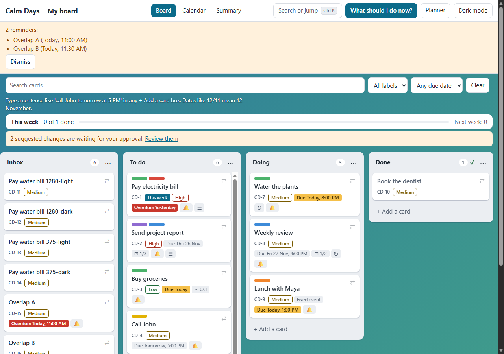
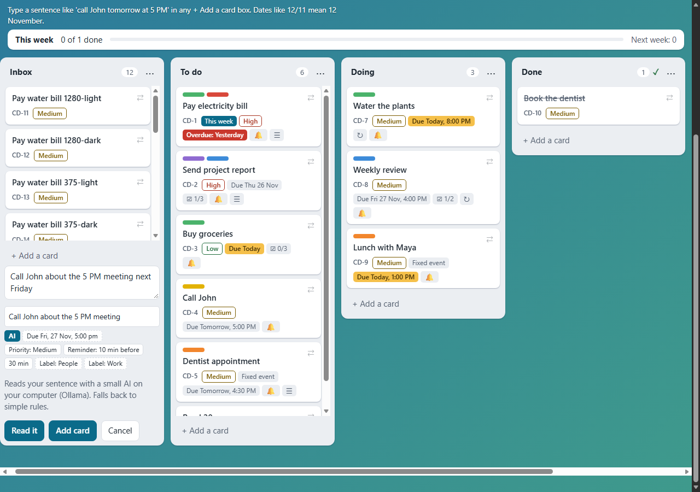
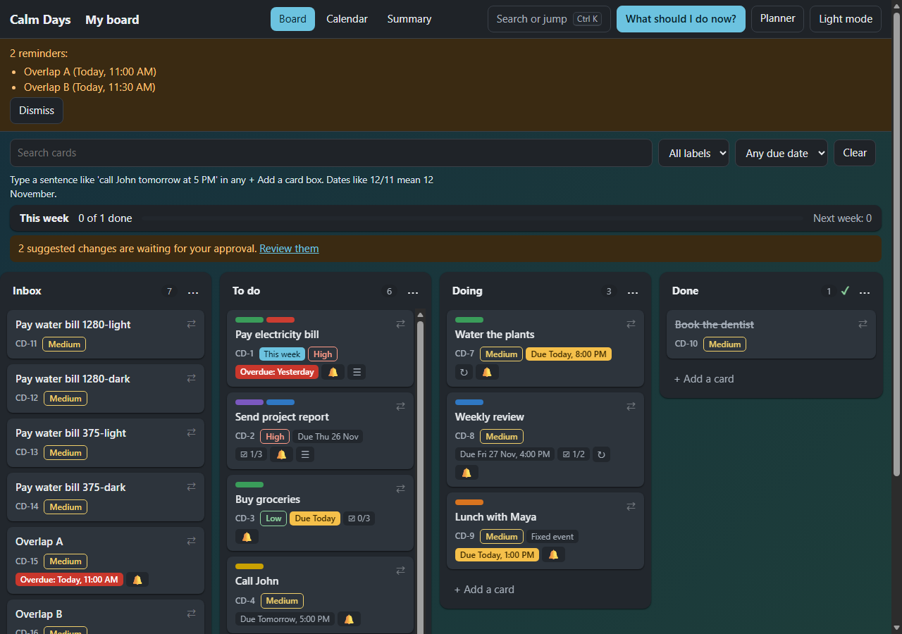
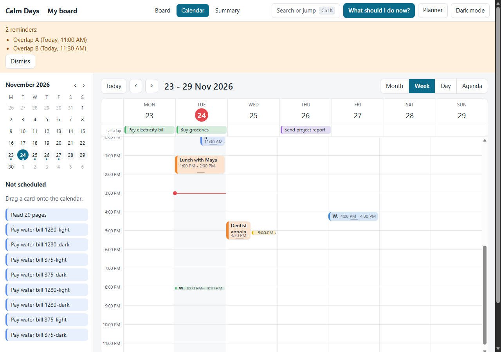
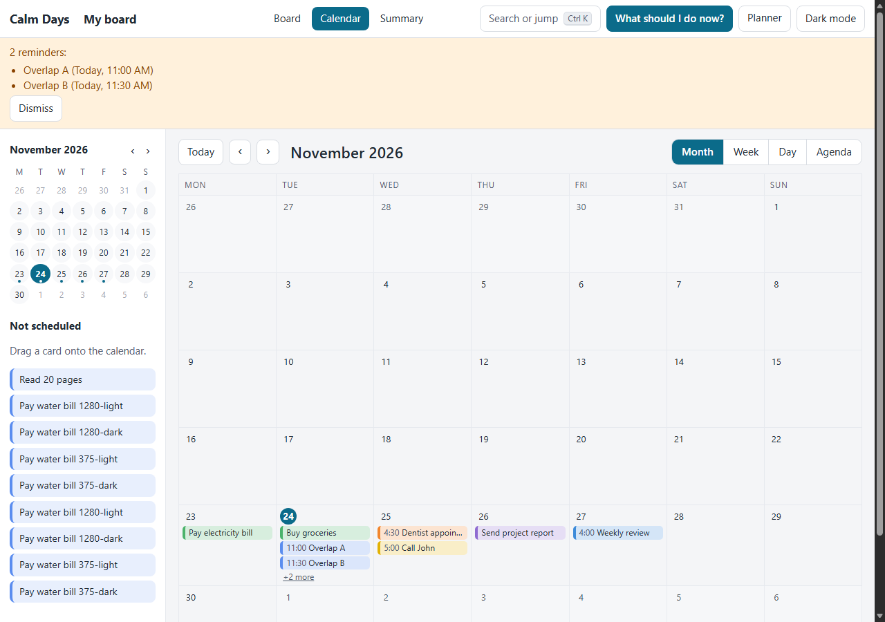
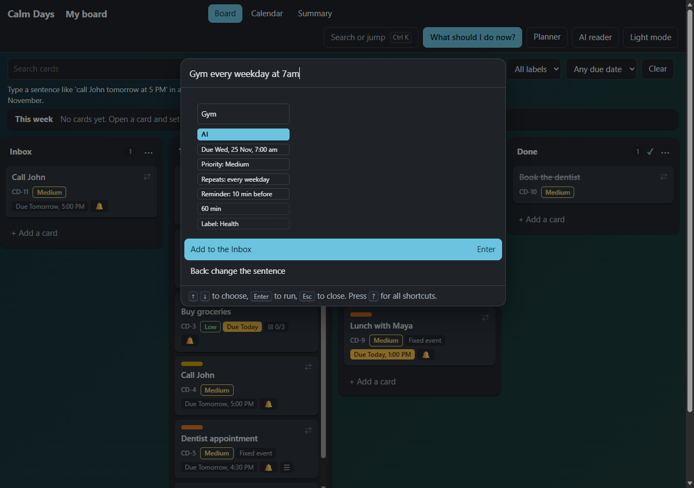
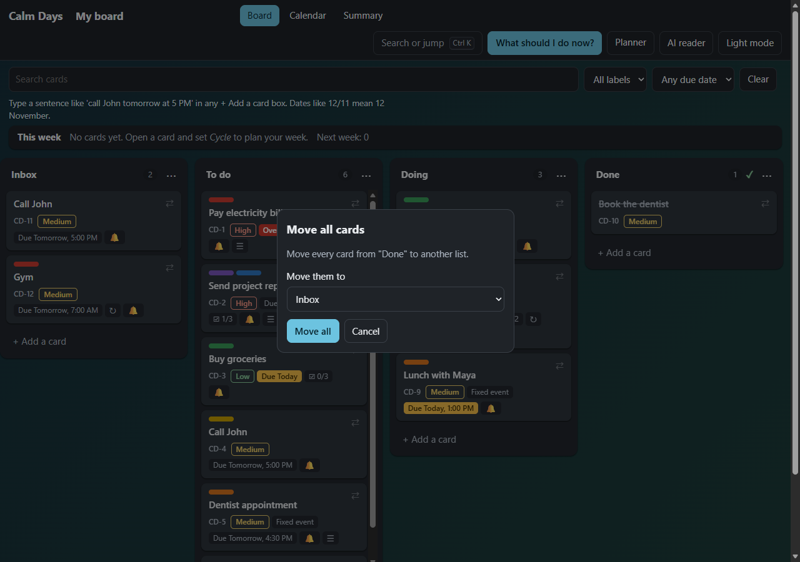
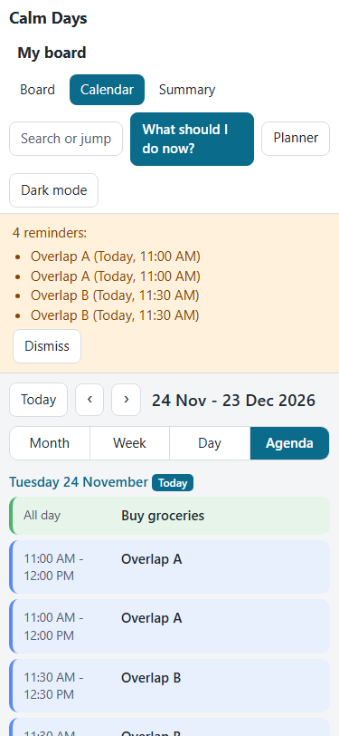

# Calm Days

**A calm to-do board and calendar. Type one sentence, and a small AI on your own PC fills in the date, time and reminder.**

Built in Rust for the Devpost hackathon "Build Your First AI App". Everything runs on your computer. Nothing is sent to the internet.



## What it does

- A board with lists (Inbox, To do, Doing, Done) and cards. Drag cards between lists.
- A calendar with Month, Week, Day and Agenda views. Drag a card onto an hour.
- Type a sentence like `Remind me to call John tomorrow at 5 PM`. The app shows the title, due date, priority, reminder and repeat as chips. You check them, then press Add card.
- `Ctrl+K` opens a command menu. It can also add a card from a sentence.
- Reminders, repeating cards, dark mode, a daily summary and a phone layout.

## How the AI works

1. You type a sentence.
2. The app asks a small model, **Qwen 3.5 0.8B**, running in [Ollama](https://ollama.com) on your own PC. The model must answer in a fixed JSON shape (a JSON schema).
3. The Rust code checks **every field**. A bad date, time, repeat or reminder is thrown away.
4. **The simple rules win on dates, times and repeats.** The model helps with the title, labels, priority words and length.
5. You see the result as chips. A dashed chip came from the AI. An `AI` chip means the model answered. A `rules` chip means the backup rules answered.
6. Nothing is saved until you press Add card.

Safety rules:

- The AI only reads one sentence. It never moves, edits or deletes your cards.
- Big changes ask first: moving 3 or more cards, archiving a list with cards, deleting events, and every "plan my day" proposal.
- If Ollama is off, the model is missing or it is slow (about 4 seconds), the rules answer instead. The app still works.
- The app only talks to `127.0.0.1` or `localhost`. Other addresses are refused in Settings.

| Sentence reading |  |
|---|---|

## Screenshots

| | |
|---|---|
|  |  |
|  |  |
|  |  |

## Quick start

### Windows

1. Install Rust from https://rustup.rs. Also install the Visual Studio C++ build tools when asked.
2. Install Ollama from https://ollama.com. Then run:
   ```
   ollama pull qwen3.5:0.8b
   ```
   (about 1 GB, one time). This step is optional. Without it the app uses the rules.
3. In this folder, double-click `start.bat`.
4. Open http://127.0.0.1:3000

The first build takes a few minutes and uses a lot of memory. Let it finish.

### Mac or Linux

```
ollama pull qwen3.5:0.8b
cargo run -j 2
```

Then open http://127.0.0.1:3000. The app opens with a sample board so you can try it at once. In the top bar, "AI reader" has a "Check it works" button.

## Tests

```
cargo test -j 2
```

98 tests pass. None of them need Ollama.

## Tech stack

Rust, Axum (web server), SQLite (through `rusqlite`, stored in `data/`), plain HTML and CSS made by the server, a small plain JavaScript file (`assets/app.js`) for drag and drop, dark mode and reminders. AI: Ollama with Qwen 3.5 0.8B.

## Honest limits

- A 0.8B model is weak on dates and times. That is why the rules decide them.
- Only tested in Microsoft Edge on Windows. Other browsers should work but are untested.
- Drag and drop does not work by touch. On phones, use the **Move to...** button.
- Reminders pop up only while the app is open in a browser tab.
- The first sentence after the model has been idle can be slow and may use the rules.
- AI labels can be silly (for example "People" on a dentist visit).
- One user, no login. The app listens on this computer only.

## Privacy

All data stays in `data/calm-days.db` on your PC. The AI runs locally. The app makes no calls to the internet.

## More

Reading rules, reminders and approvals in detail: [docs/details.md](docs/details.md).
Devpost text and demo script: [devpost.md](devpost.md).

## License

MIT. See [LICENSE](LICENSE).
